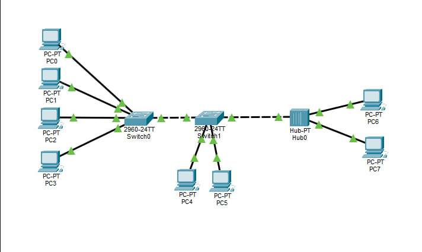
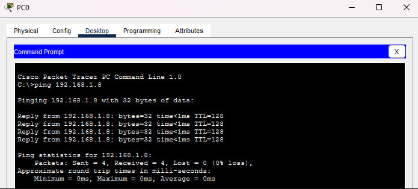
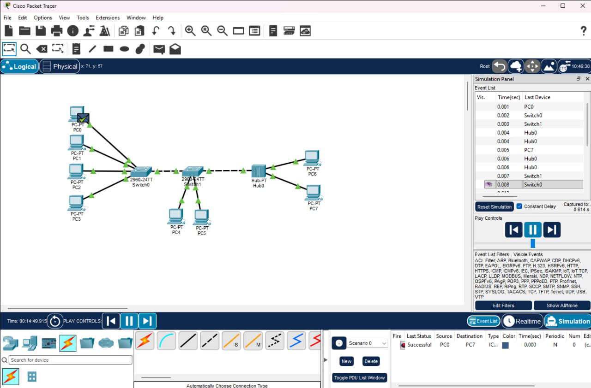

# Локальная сеть в Cisco Packet Tracer

## Состав сети
- 8 компьютеров
- 2 коммутатора Cisco 2960
- 1 концентратор Hub-PT
- Подсеть: 192.168.1.0/24

## Проверка
Выполнен ping от PC0 (192.168.1.1) до PC7 (192.168.1.8).
Результат: 4 пакета отправлено, 4 получено, потерь нет.

## Скриншоты

### 1. Схема сети

### 2. Проверка ping через консоль

### 3. Ping в режиме Simulation
