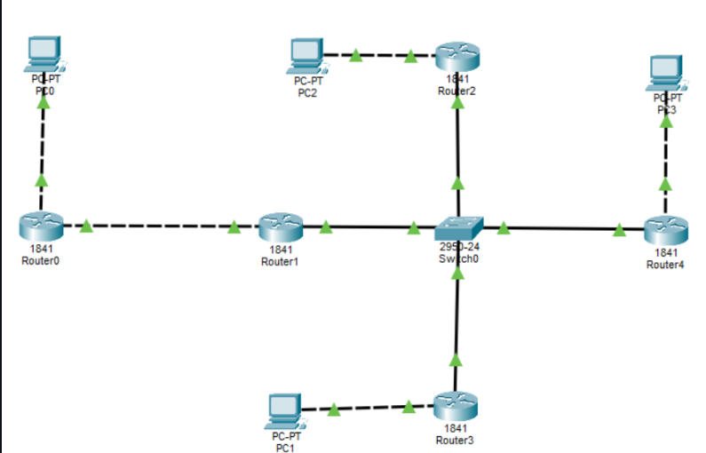
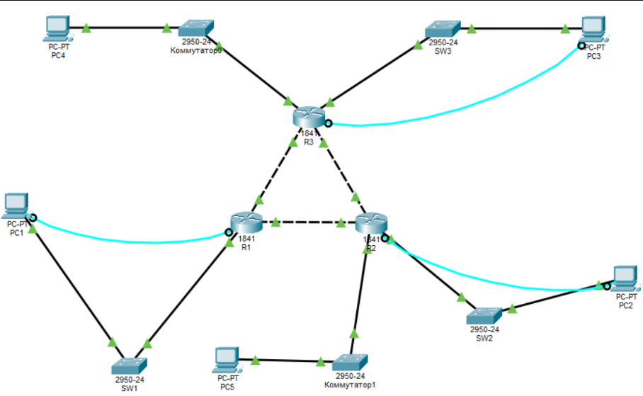
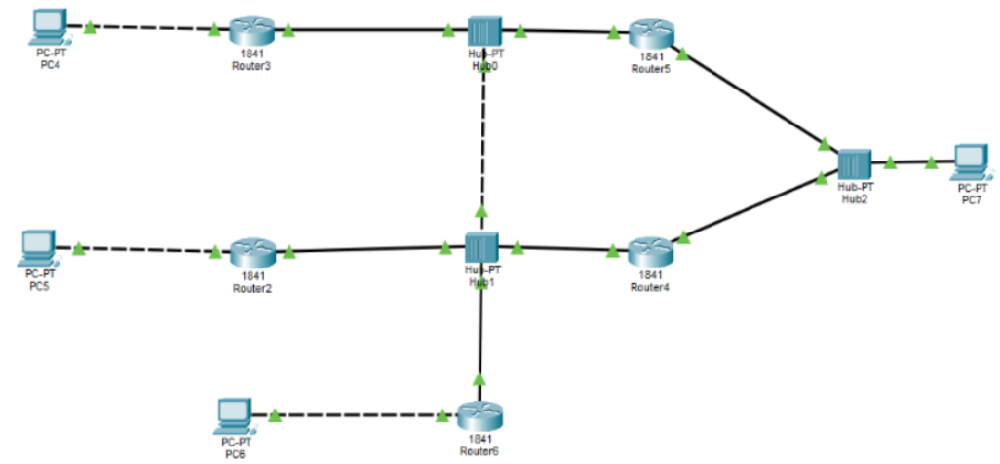

### Схема 1

Топология включает 4 ПК (PC0–PC3), 5 маршрутизаторов Cisco 1841 (Router0–Router4) и коммутатор 2950-24 (Switch0). Каждый ПК соединен с отдельным маршрутизатором. Маршрутизаторы связаны друг с другом типа «звезда» через центральный коммутатор Switch0.

---

### Схема 2

Сеть включает три маршрутизатора Cisco 1841 (R1–R3), объединённых в топологию «треугольник» посредством перекрёстных кабелей. Связь с пятью компьютерами (PC1–PC5) организована через пять коммутаторов Cisco 2950-24 (SW1–SW3, а также Коммутатор0 и Коммутатор1). Голубыми линиями отмечены консольные подключения от ПК PC1, PC2 и PC3 к соответствующим маршрутизаторам для их настройки.

---

### Схема 3

Сеть включает четыре компьютера (PC4–PC7), пять маршрутизаторов Cisco 1841 (Router2–Router6) и три концентратора (Hub0–Hub2). Связь между маршрутизаторами организована через общие сегменты на базе концентраторов: Router3 и Router5 подключены к Hub0; Router2, Router4 и Router6 — к Hub1; Router4 и Router5 дополнительно соединены с Hub2, к которому также подключён PC7. Компьютеры PC4, PC5 и PC6 подключены напрямую к маршрутизаторам Router3, Router2 и Router6 соответственно.