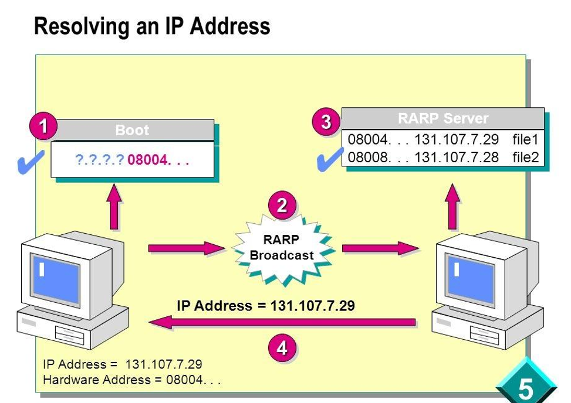
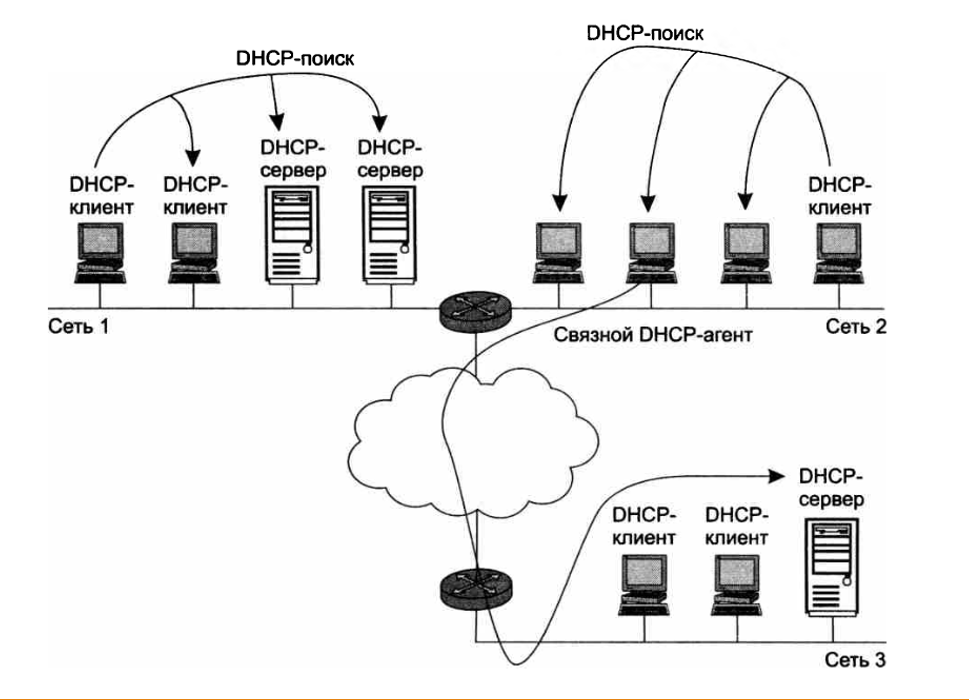

# Конспект: Протокол DHCP (Dynamic Host Configuration Protocol)

## 1. Введение и назначение DHCP

Для нормальной работы сети каждому сетевому интерфейсу компьютера и маршрутизатора необходим IP-адрес и сопутствующие параметры стека TCP/IP (маска подсети, IP-адрес маршрутизатора по умолчанию, IP-адрес DNS-сервера, доменное имя и т. д.).

- **Ручное конфигурирование:** Администратор вручную заполняет формы на каждом устройстве.
- **Минусы:** Утомительно даже для малых сетей, высок риск ошибок и дублирования адресов.
- **Автоматизация (DHCP):** Протокол динамического конфигурирования хостов автоматизирует процесс настройки и гарантирует отсутствие дублирования за счет централизованного управления.

## 2. DHCP и его прародители

### 2.1. RARP (Reverse Address Resolution Protocol)

Одна из первых реализаций протокола для выдачи IP-адресов появилась более 30 лет назад. Клиент делал широковещательный запрос, сервер находил в базе данных привязку MAC-адреса клиента к IP и отправлял ответ.

**Минусы RARP:**

- Требовалось настраивать сервер в каждом сегменте локальной сети и регистрировать MAC-адреса.
- Передавать дополнительную информацию клиенту не было возможности.

### 2.2. BOOTP (Bootstrap Protocol)

- Создан изначально для бездисковых рабочих станций.
- Выдавал IP-адрес, а также передавал дополнительную информацию: адрес TFTP-сервера и имя файла загрузки.
- Поддерживал relay (связные агенты) — небольшие сервисы, пересылающие запросы «главному» серверу. Это позволило использовать один сервер для нескольких сетей.

DHCP является совместимым расширением BOOTP (DHCP-сервер поддерживает устаревших клиентов, но не наоборот).

## 3. Режимы работы DHCP

Протокол работает по модели клиент-сервер. Администратор задает диапазон IP-адресов одной сети (пул) и режим работы:

- **Ручное назначение (статические адреса):** Администратор жестко связывает MAC-адрес (или идентификатор) клиента с конкретным IP-адресом.
- **Автоматическое назначение статических адресов:** Сервер самостоятельно произвольно выбирает IP из пула и закрепляет его за клиентом навсегда при первом обращении.
- **Динамическое распределение адресов:** Адрес выдается на ограниченное время (срок аренды). При отключении устройства или переходе в другую подсеть адрес автоматически освобождается.

**Пример эффективности динамического распределения:**

В организации 500 мобильных сотрудников, но в офисе единовременно присутствует не более 50 человек.

Вместо приобретения 500 постоянных адресов достаточно получить пул из 64 адресов и настроить динамический DHCP. Сотрудники будут получать временные IP при подключении.

## 4. Алгоритм динамического назначения адресов

**Основные понятия:**

- **Пул адресов и срок аренды** (определяет, как долго компьютер может использовать IP перед повторным запросом; зависит от специфики сети — от часов для учебных классов до недель для корпоративных сетей).
- **Связной DHCP-агент:** Посредник между клиентами и серверами, помогающий обслуживать несколько сетей одним удаленным сервером.

**Порядок обмена сообщениями (DORA / 6 шагов):**

1. **DHCP-поиск (Discover):** Компьютер при включении шлет широковещательное сообщение (255.255.255.255).
2. **Пересылка:** Локальный сервер или связной агент принимает запрос и при необходимости пересылает его в другую сеть.
3. **DHCP-предложение (Offer):** Сервер(ы) присылают клиенту свои предложения с IP-адресом и параметрами.
4. **DHCP-запрос (Request):** Клиент выбирает первое предложение и отправляет широковещательный запрос с подтверждением выбранного сервера.
5. **Подтверждение (Acknowledge):** Выбранный сервер присылает положительную квитанцию, а остальные аннулируют свои предложения.
6. **Рабочее состояние:** Клиент переходит к штатной работе с полученными параметрами.

## 5. Проблемы динамических адресов и их решения

Из-за непостоянства IP-адресов возникают сложности:

### Интеграция с DNS

- **Проблема:** DNS-таблицы не успевают обновляться при частой смене IP.
- **Решение:** Критическим серверам назначают статические IP, а для остальных используют динамическую систему DNS (DDNS), синхронизированную с DHCP.

### Удаленное управление и мониторинг

- **Проблема:** Сложно собирать статистику и управлять устройствами с плавающими адресами.
- **Решение:** Маршрутизаторам, серверам и принтерам всегда выделяют статические IP-адреса.

### Безопасность и фильтрация пакетов

- **Проблема:** Усложняется фильтрация пакетов по IP-адресам на сетевых экранах.
- **Решение:** Отказ от динамического назначения для инфраструктурных и защищаемых узлов.