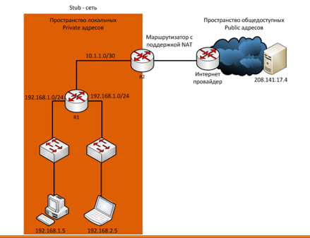
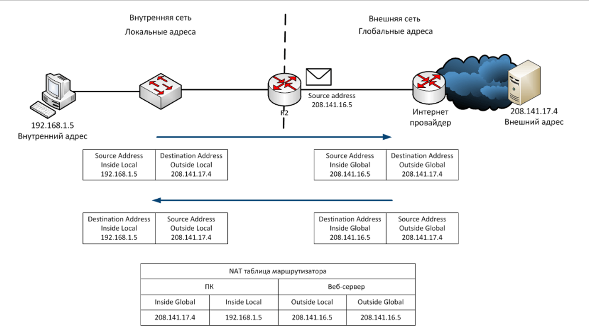
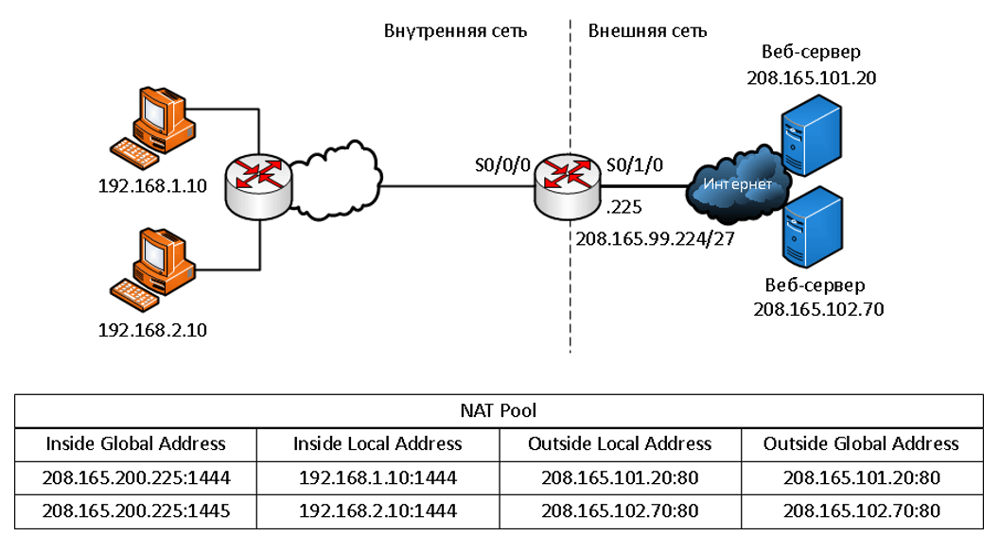
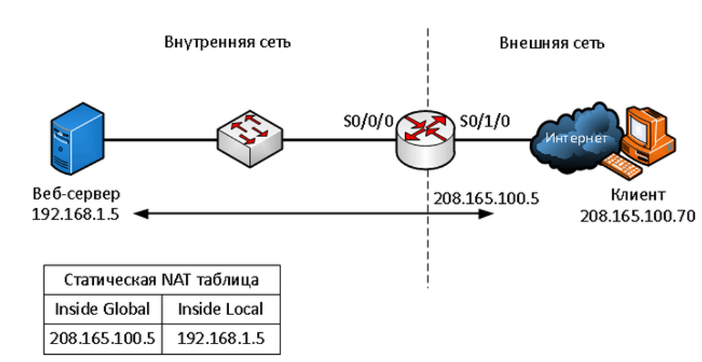
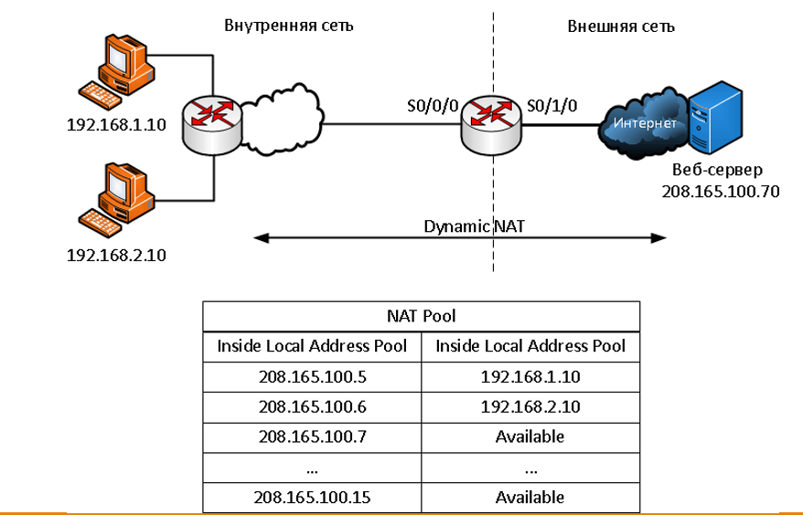

# Технология NAT — краткий конспект

## 1. Зачем нужен NAT

IPv4 даёт всего **~4,3 млрд адресов** — этого мало. Долгосрочное решение — IPv6, но быстрым решением стал **NAT**.

**NAT (Network Address Translation)** — переводит **приватные** IPv4-адреса в **публичные** и обратно.

**Частные диапазоны:**
- `10.0.0.0/8`
- `172.16.0.0/12`
- `192.168.0.0/16`

Не маршрутизируются в интернете. Один публичный адрес может обслуживать **сотни и тысячи** устройств. NAT также **скрывает внутренние адреса** от внешних сетей.



---

## 2. Терминология NAT

| Тип адреса | Что означает |
|---|---|
| **Inside local** | Адрес источника, видимый из внутренней сети |
| **Inside global** | Адрес источника, видимый из внешней сети |
| **Outside local** | Адрес получателя, видимый из внутренней сети |
| **Outside global** | Адрес получателя, видимый из внешней сети |

- **Inside / Outside** — относительно транслируемого устройства.
- **Local / Global** — где адрес виден (внутри / снаружи).



**Путь пакета:** ПК `192.168.1.5` (Inside Local) → адрес меняется на `208.141.16.5` (Inside Global) → веб-сервер `208.141.17.4`. Ответ идёт обратно, роутер по таблице NAT возвращает исходный адрес.

---

## 3. Три типа NAT

### Static NAT (1:1)
- Ручное постоянное сопоставление **один к одному**.
- Для веб-серверов и устройств с постоянным публичным адресом.

### Dynamic NAT (многие:многие)
- Пул публичных адресов, выдаётся по принципу **«первым пришёл — первым обслужен»**.
- Нужно столько же публичных адресов, сколько одновременных сессий.

### PAT / NAT Overload (многие:1)
- **Самая распространённая форма.** Много частных адресов → один публичный.
- Различает сессии по **номерам портов TCP/UDP**.
- На один адрес теоретически до **65 536** сессий, на практике ~**4 000**.
- Если порт занят — PAT берёт следующий свободный (например, 1444 → 1445).
- Для ICMP вместо порта использует **Query ID**.



---

## 4. Преимущества и недостатки

**Плюсы:**
- Экономия публичных IPv4.
- Гибкость подключения к публичной сети.
- Сохранение внутренней схемы адресации при смене провайдера.
- Скрытие внутренней топологии (⚠️ но NAT **не заменяет файрвол**).

**Минусы:**
- Задержки для real-time протоколов (VoIP).
- Теряется сквозная адресация (end-to-end) — часть приложений не работает.
- Сложнее трассировка через несколько NAT.
- Проблемы с туннелями (IPsec) и протоколами без портов (stateless UDP, входящие TCP).

---

## 5. Настройка Static NAT

Сопоставление **1:1**, постоянно в таблице NAT.



```
Router(config)# ip nat inside source static 192.168.1.5 208.165.100.5
Router(config)# interface serial0/0/0
Router(config-if)# ip nat inside
Router(config-if)# exit
Router(config)# interface serial0/1/0
Router(config-if)# ip nat outside
```

Проверка: `show ip nat translations`, `show ip nat statistics`, `clear ip nat statistics`.

---

## 6. Настройка Dynamic NAT

Использует **пул публичных адресов** и **ACL**.



```
Router(config)# ip nat pool POOL 208.165.100.5 208.165.100.15 netmask 255.255.255.0
Router(config)# access-list 1 permit 192.168.0.0 0.0.255.255
Router(config)# ip nat inside source list 1 pool POOL
Router(config)# interface serial0/0/0
Router(config-if)# ip nat inside
Router(config-if)# exit
Router(config)# interface serial0/1/0
Router(config-if)# ip nat outside
```

Проверка: `show ip nat translations` (записи живут 24 ч по умолчанию), `clear ip nat translation` (только динамические), `show ip nat statistics`, `show access-lists`.

---

## 7. Настройка PAT

### 7.1. PAT для пула адресов

Отличается от Dynamic NAT ключевым словом **`overload`**.

```
Router(config)# ip nat pool POOL 208.165.100.5 208.165.100.15 netmask 255.255.255.0
Router(config)# access-list 1 permit 192.168.0.0 0.0.255.255
Router(config)# ip nat inside source list 1 pool POOL overload
Router(config)# interface serial0/0/0
Router(config-if)# ip nat inside
Router(config-if)# exit
Router(config)# interface serial0/1/0
Router(config-if)# ip nat outside
```

### 7.2. PAT для одного адреса

Использует адрес самого интерфейса:

```
Router(config)# access-list 1 permit 192.168.0.0 0.0.255.255
Router(config)# ip nat inside source list 1 interface serial0/1/0 overload
Router(config)# interface serial0/0/0
Router(config-if)# ip nat inside
Router(config-if)# exit
Router(config)# interface serial0/1/0
Router(config-if)# ip nat outside
```

---

## 8. Практика в Cisco Packet Tracer (кратко)

1. **Топология:** 3 ПК в VLAN2, сервер в VLAN3, коммутатор 2960, Router0 (1841); у «провайдера» — Router1 и Server1.
2. **Коммутатор:** создать VLAN 2 (users) и VLAN 3 (server), назначить порты, `Fa0/5` — trunk.
3. **Router0:** поднять `Fa0/0`, создать субинтерфейсы `fa0/0.2` (VLAN2) и `fa0/0.3` (VLAN3) с `encapsulation dot1Q`.
4. **IP-адресация:** ПК `192.168.2.2–4`, сервер `192.168.3.2`.
5. **Провайдер Router1:** `Fa0/0 = 213.234.10.1/30`, `Fa0/1 = 213.234.20.1/30`, Server1 = `213.234.20.2`.
6. **Router0 (граница):** `Fa0/1 = 213.234.10.2/30` + маршрут по умолчанию `ip route 0.0.0.0 0.0.0.0 213.234.10.1`.
7. **Проблема:** без NAT ПК не пингуют провайдера — провайдер не знает про «серые» адреса.
8. **Настройка NAT:** `Fa0/1` → `ip nat outside`, `Fa0/0.2/0.3` → `ip nat inside`; ACL `FOR-NAT`; `ip nat inside source list FOR-NAT int fa0/1 overload` (это PAT).
9. **Проверка:** `ping 213.234.20.2` работает, `show ip nat translations` показывает сессии.
10. **Static NAT для веб-сервера:** включить HTTP, заменить надпись; затем
```
ip nat inside source static tcp 192.168.3.2 80 213.234.10.2 80
```
Проверка из внешней сети через браузер на Server1.

---

## 9. Шпаргалка: маски подсети

| Префикс | Маска | Адресов |
|---|---|---|
| /30 | 255.255.255.252 | 4 |
| /29 | 255.255.255.248 | 8 |
| /28 | 255.255.255.240 | 16 |
| /26 | 255.255.255.192 | 64 |
| /25 | 255.255.255.128 | 128 |
| /24 | 255.255.255.0 | 256 |
| /23 | 255.255.254.0 | 512 |
| /22 | 255.255.252.0 | 1024 |
| /21 | 255.255.248.0 | 2048 |
| /20 | 255.255.240.0 | 4096 |
| /16 | 255.255.0.0 | 65536 |