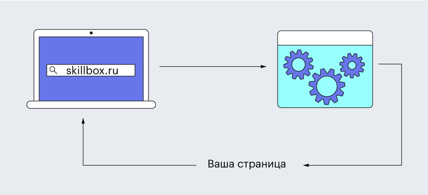
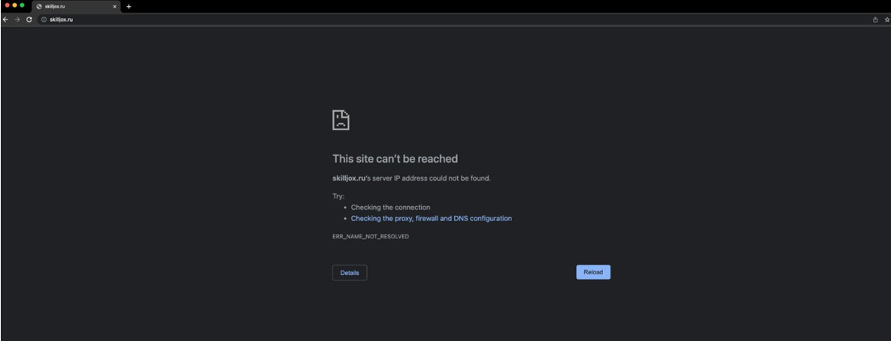
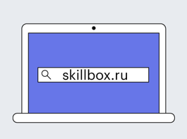
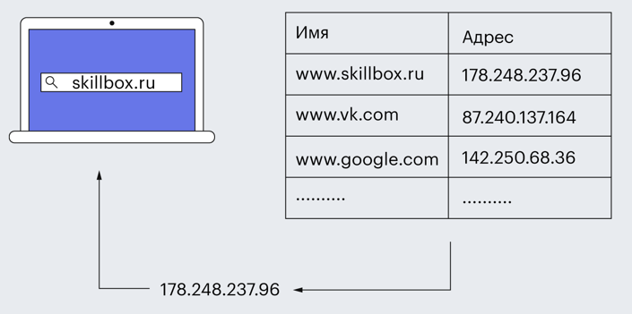
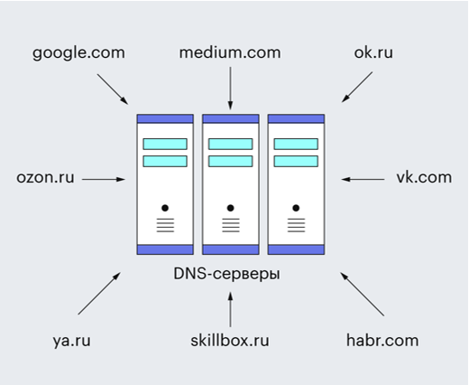
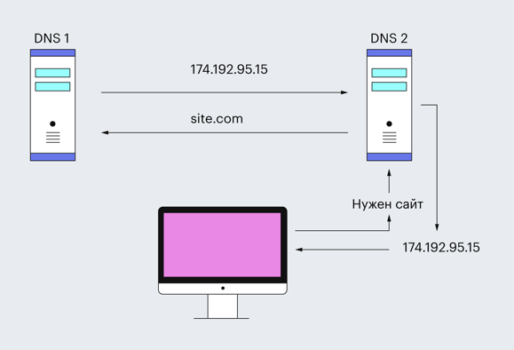
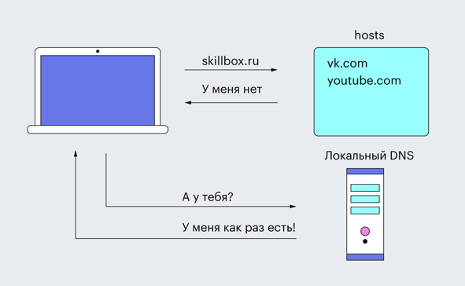
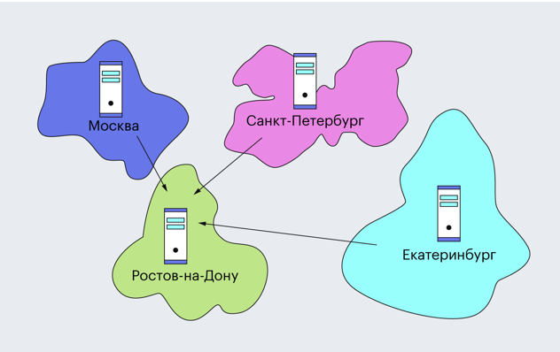

# Конспект по DNS

## 1. Что такое DNS

**DNS (Domain Name System)** — распределённая система, помогающая браузерам находить адреса сайтов по их именам.

**Предпосылки:**
- До DNS информацию о сайтах заносили вручную (во времена ARPANET).
- Таблица росла, обслуживание усложнялось — так появилась автоматизированная система DNS.

**Принцип работы:**
- DNS — это база данных с перечнем сайтов, но данные заносятся автоматически.
- При вводе `skillbox.ru` браузеру нужен **IP-адрес** — его и находит DNS.
- Весь интернет работает с IP-адресами, а имена нужны для удобства людей.

---

## 2. Как работает DNS

**Аналогия с телефонной книгой:**
- DNS похож на телефонную книгу: имя сайта — как имя абонента, IP — как номер телефона.
- Если сайт найден — подключение; если нет — ошибка.

**Различие:** по телефону звонят по номерам, а к сайтам подключаются по именам, но у каждого сайта есть свой IP-адрес.

**Пример таблицы:**

| Имя | Адрес |
|-----|-------|
| www.skillbox.ru | 178.248.237.96 |
| www.vk.com | 87.240.137.164 |
| www.google.com | 142.250.68.36 |

**Пример работы:** вводите `www.skillbox.ru` → сервер ищет IP → возвращает `178.248.237.96` → браузер открывает страницу.

---

## 3. Что такое DNS-сервер

**DNS-сервер** — компьютеры, на которых хранятся IP-адреса сайтов, привязанные к именам.

- Есть у каждого провайдера, VPN-сервиса, IT-компаний.
- Бывают крупные и персональные (можно настроить даже на телефоне, например для блокировки рекламы).

---

## 4. Зачем нужны DNS-серверы

**Задачи:**
- Хранить данные о доменах и отдавать их по запросам.
- Кэшировать записи с других серверов для ускорения.
- Работать в связке — один сервер не хранит всё.

**Процесс поиска:**
1. Пользователь вводит имя сайта.
2. Компьютер проверяет файл **hosts** (локальные IP-адреса).
3. Если адреса нет — запрос идёт на локальный DNS-сервер провайдера.

**Взаимодействие серверов:** локальный сервер обращается к региональным, получает информацию и возвращает пользователю.

**Кэширование:** найденный IP сохраняется в памяти, поэтому повторное открытие сайта быстрее. Кэш периодически очищается, а при смене IP обновляется в течение суток.

---

## 5. Типы записей DNS

**DNS-зона** — файлы со связями между доменами, IP-адресами, поддоменами и почтовыми серверами.

| Тип | Назначение |
|-----|-----------|
| **A** | IP-адрес сайта |
| **MX** | адрес почтового сервера |
| **CNAME** | запись для поддоменов |
| **NS** | адрес сервера с ресурсными записями |
| **TXT** | текстовая информация о домене |
| **SPF** | серверы, отправляющие письма от имени домена |
| **SOA** | главная запись зоны |

---

## 6. SOA-записи

**SOA (Start Of Authority)** — «Начало Зоны», начальная запись зоны.

- Доменные серверы объединены в кластеры и синхронизируются через передачу зон.
- **Зона** — совокупность ресурсных записей домена.
- SOA хранит сведения для обмена: идентификаторы, время кэширования, контакты администратора.
- Без SOA обмен невозможен, запись обязательна в файлах зон.

**Формат SOA:**

| Поле | Описание |
|------|----------|
| **Primary Name Server** | имя первичного DNS-сервера |
| **Hostmaster** | контакт администратора (вместо `@` — `.`) |
| **Serial number** | серийный номер (меняется при обновлении) |
| **Refresh** | время ожидания вторичного DNS перед запросом SOA |
| **Retry** | время повторной попытки синхронизации |
| **Expire** | время, после которого зона перестаёт обслуживаться |
| **Minimum TTL** | минимальное время жизни записей в кэше |

---

## 7. Главные DNS-серверы

- **13 корневых серверов** — в них информация обо всех сайтах.
- С копиями по миру — **123 сервера**.
- Распределение: 40 — Северная Америка, 35 — Европа, 6 — Южная Америка, 3 — Африка, 39 — остальные.
- В России 5 копий: Москва, Санкт-Петербург, Ростов-на-Дону, Новосибирск, Екатеринбург.

---

## 8. DNS как протокол

- Относится к прикладному уровню модели OSI, есть во всех ОС.
- В 2010 добавлено расширение **DNSSEC** — защита от подмены IP-адресов.

**Характеристики системы:**
- **Распределённость администрирования** — за части отвечают разные организации.
- **Распределённость хранения** — каждый сервер хранит свою зону.
- **Кэширование** — временное хранение данных для снижения нагрузки.
- **Иерархическая структура** — древовидная схема серверов.
- **Резервирование** — дублирование информации на разных серверах.

---

## 9. Уровни доменов

Доменное имя состоит из частей, разделённых точками; уровни идут **справа налево**.

**Домен нулевого уровня** — корневой (`root domain`), отмечается точкой, не отображается в браузере. Пример: `go.skillbox.ru.`

**Домен первого уровня** — доменные зоны:
- **Национальные (ccTLD)**: `.ru`, `.рф`, `.su`, `.de`, `.uk`.
  - В некоторых зонах регистрация только для граждан/организаций страны: `.us`, `.eu`, `.ee`, `.ua`, `.az`, `.ie`.
- **Общие (gTLD)**: `.com`, `.info`, `.biz`, `.name`, `.org`.

**Домен второго уровня** — основной домен (название сайта). `skillbox.ru` и `skillbox.com` — разные имена. Регистрацией занимаются аккредитованные **ICANN** организации.

**Домен третьего уровня** — поддомен/субдомен. Пример: `ru.wikipedia.org`, `en.wikipedia.org`. Используется для форумов, услуг, региональных представительств. Уровни выше третьего редки из-за длины.

---

## 10. Что запомнить

- **DNS** — проводник в интернете, помогает браузерам находить адреса сайтов.
- Состоит из **протокола** (передача данных и поиск IP) и **серверов** (хранение информации).
- На серверах данные хранятся в виде разных типов записей для удобства поиска.