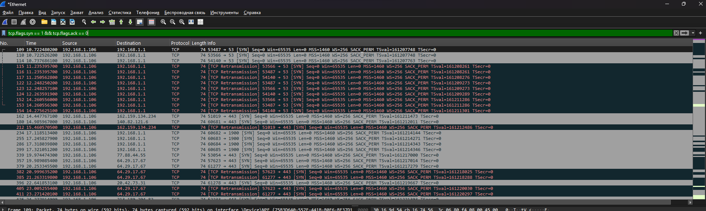
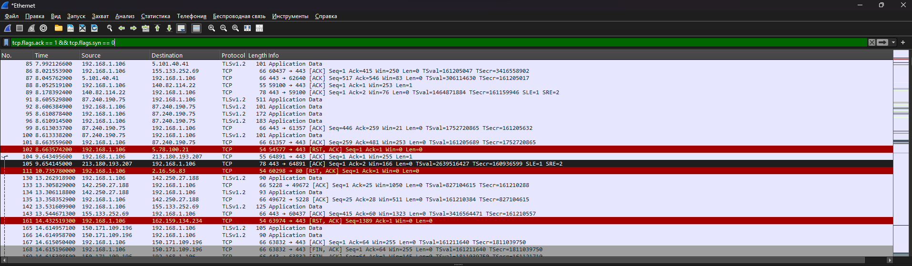
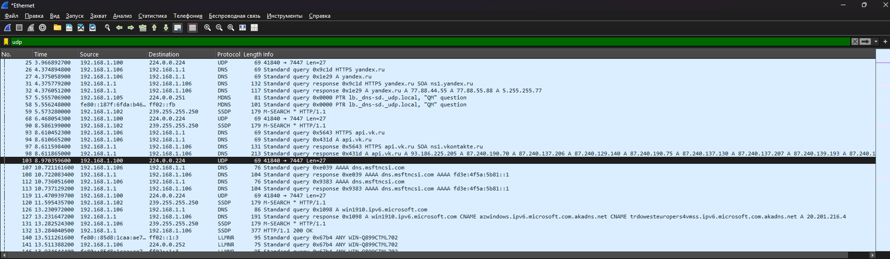

# Отчёт

## Цель
Изучить работу сетевых протоколов TCP и UDP с помощью анализатора трафика Wireshark.

## Инструменты
- Wireshark 4.6.9
- Интерфейс захвата: Ethernet

## 1. TCP с флагом SYN

Фильтр: `tcp.flags.syn == 1 && tcp.flags.ack == 0`

Описание: пакеты с установленным флагом SYN и снятым ACK — это
первый этап установления TCP-соединения (клиент запрашивает
соединение с сервером).

## 2. TCP с флагом ACK

Фильтр: `tcp.flags.ack == 1 && tcp.flags.syn == 0`

Описание: пакеты с установленным флагом ACK — подтверждения
получения данных, основной тип пакетов в установленном
TCP-соединении.

## 3. UDP

Фильтр: `udp`

Описание: пакеты протокола UDP. В захвате видны DNS-запросы,
mDNS, SSDP и LLMNR — все они работают поверх UDP.

## Вывод
В ходе работы освоен базовый захват и фильтрация трафика
в Wireshark. Наглядно показаны различия между TCP (с флагами
SYN и ACK) и UDP.